<p align="center">
  
</p>

<p align="center">
  <a href="https://www.linkedin.com/in/rahul-kumar-059a25333/" target="_blank">
    
  </a>
  <a href="mailto:ra.ko774808@gmail.com">
    
  </a>
  <a href="https://github.com/rahulkumar128667-blip">
    
  </a>
  <a href="https://maps.google.com/?q=Rajkot,+Gujarat,+India" target="_blank">
    
  </a>
</p>

---

### 💫 About Me

```yaml
name: Rahul Kumar
title: Computer Engineering Student & Full-Stack / AI Developer / Data Science / Agentic AI 
institution: Marwadi University, Rajkot, India
passions: [Full-Stack Development, .NET Architecture, Machine Learning, Open Source]
motto: "Dreaming Big | Working Hard | Learning Something New Everyday"
```

- 🎓 **Education:** Pursuing **B.Tech in Computer Engineering** at **Marwadi University**, Rajkot, India.
- 💻 **Specializations:** Full-Stack Web Development, .NET Enterprise Solutions, and AI & Machine Learning.
- 🔭 **Current Work:** Crafting scalable web applications, training predictive ML models, and participating in hackathons.
- 🐾 **Flagship Project:** **[PetSathi](https://github.com/rahulkumar128667-blip/PetSathi)** — An open-source community platform created for **NSoC Winter Edition**, connecting pet parents with verified walkers.
- 🚀 **Full-Stack Project:** **[Taskflow](https://github.com/rahulkumar128667-blip/taskflow)** — A clean, production-ready collaborative task manager built with MongoDB, Express, React, and Node.js.
- 🌱 **Currently Mastering:** Generative AI pipelines, Deep Learning fundamentals, and Cloud deployments.
- 👯 **Open to Collaborate On:** Real-world Full-Stack applications, AI/ML tools, Hackathons, and Open-Source projects.
- 💬 **Ask Me About:** `C#`, `.NET`, `Python`, `React`, `Node.js`, `MongoDB`, `MySQL`, and `Git/GitHub`.
- ⚡ **Fun Fact:** I love turning complex problem statements into functional, beautiful digital products!

---

### 🛠️ Tech Stack & Skills

<p align="center">
  <b>Programming Languages</b><br/>
  <a href="https://skillicons.dev">
    
  </a>
</p>

<p align="center">
  <b>Frameworks, Libraries & Runtimes</b><br/>
  <a href="https://skillicons.dev">
    
  </a>
</p>

<p align="center">
  <b>Databases, DevOps & Tools</b><br/>
  <a href="https://skillicons.dev">
    
  </a>
</p>

<p align="center">
  
  
  
  
</p>

---

### 📌 Featured Repositories

| Project | Description | Tech Stack | Link |
| :--- | :--- | :--- | :---: |
| 🐾 **PetSathi** | Community pet-care platform for **NSoC Winter Edition** connecting pet owners with trusted caretakers. | `HTML5` `CSS3` `JavaScript` `PHP` `MySQL` | [🔗 View Repo](https://github.com/rahulkumar128667-blip/PetSathi) |
| 📋 **Taskflow** | Modern collaborative task manager built for seamless team productivity and first open-source contributions. | `MongoDB` `Express` `React` `Node.js` | [🔗 View Repo](https://github.com/rahulkumar128667-blip/taskflow) |
| 📦 **Inventory Management** | Enterprise-grade inventory module with ADO.NET and complete CRUD operations. | `C#` `.NET` `ADO.NET` `SQL` | [🔗 View Repo](https://github.com/rahulkumar128667-blip/Inventory-Management-Module-using-ADO.NET-and-CRUD-Operations) |
| 📊 **Placement Dashboard** | Campus placement analytics platform using Data Controls and Crystal Reports. | `C#` `.NET` `Crystal Reports` | [🔗 View Repo](https://github.com/rahulkumar128667-blip/Placement-Dashboard-using-Data-Controls-Crystal-Reports) |

---

### 📊 GitHub Analytics

<p align="center">
  
  
</p>

<p align="center">
  
</p>

---

### 📊 Data Science & Dev Inspiration

<p align="center">
  
</p>

---

<p align="center">
  
</p>

<p align="center">
  
</p>
